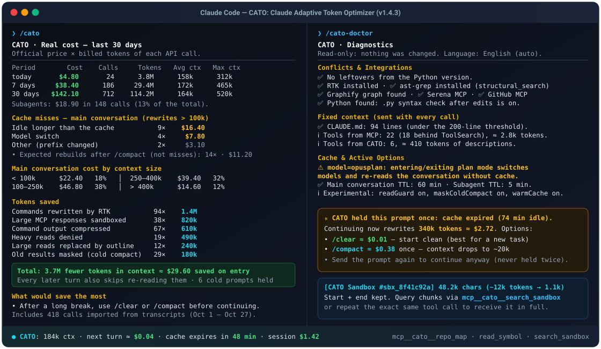

# CATO: Claude Adaptive Token Optimizer

[](https://hub.xerj.org/contributors/marcusaguiarmaciel-cmd)
[](https://github.com/sponsors/marcusaguiarmaciel-cmd)
[](https://github.com/marcusaguiarmaciel-cmd/cato-plugin/releases)
[](https://github.com/marcusaguiarmaciel-cmd/cato-plugin)
[](https://github.com/marcusaguiarmaciel-cmd/cato-plugin/tree/main/plugin/tests)

[Português](README.pt-BR.md)

A Claude Code plugin that cuts token cost with context and prompt-cache control, automatic compaction, compression of noisy output and efficient code navigation. It runs entirely inside Claude Code, with no Python and no external process per hook, and integrates with Serena, Graphify, ast-grep and GitHub MCP.

> **100% Local & Offline:** Zero network calls, zero telemetry, and zero external npm dependencies.

<p align="center">
  
</p>

## Quick Start (30-Second Cost & Cache Audit)

Requires Claude Code **2.1.290 or newer** (`claude update`).

1. **Install CATO:**
   ```
   /plugin install cato --marketplace marcusaguiarmaciel-cmd/cato-plugin
   ```
2. **Audit your past sessions (instant, read-only):**
   ```
   /cato-import
   /cato
   ```
   Reads your existing local `.jsonl` transcripts and shows your real 30-day token spend, cache misses by cause (idle TTL expiration, model switches, subagents), and context-band breakdown.
3. **Check your setup for token leaks:**
   ```
   /cato-doctor
   ```

## Language

Reports, warnings and the status line come in **English, Portuguese or Spanish**. CATO picks the language in this order:

1. The `language` option in CATO's settings (`/plugin`): `auto` (default), `en`, `pt` or `es`.
2. Claude Code's `language` setting (for example `"language": "portuguese"` in `settings.json`).
3. The system locale (`LC_ALL`, `LC_MESSAGES`, `LANG`, or the OS locale).
4. English. A configured language CATO does not support also falls back to English.

What only the model reads (denials, compression footers, tool descriptions, the skill) is always in English: it costs fewer tokens and works with any conversation language. `/cato-doctor` shows which language is in use and where it came from.

## Commands

| Command | What it shows |
|---|---|
| `/cato [days]` | Real cost per period, cache misses by cause, cost by context size, tokens saved per intervention (including RTK via `rtk gain`) and recommendations. Default: 30 days |
| `/cato-import` | Adds sessions from before the install, read from the transcripts, without counting anything twice |
| `/cato-doctor` | Read-only diagnostics: language, leftovers of the Python version, double auto-compaction, integrations, `CLAUDE.md` over 200 lines, too many MCP servers, `opusplan` and mismatched TTLs |
| `/cato-share [days]` | Compact 5-line audit card (spend, cache misses and tokens saved, with no project names or paths) ready to copy and share |
| `/cato-experimental [on\|off\|default]` | Shows or toggles the experimental features |

`/cato import`, `/cato doctor`, `/cato share` and `/cato experimental …` also work. Portuguese and Spanish words are accepted too (`compartilhar`, `compartir`, `ligar`, `desligar`, `padrão`, `activar`, `desactivar`, `predeterminado`).

## What it does

| Feature | How |
|---|---|
| Context/cache guard | Warns per context band and holds the prompt **once** when the cache expired and rewriting it would cost ≥ `guardBlockUsd` |
| Auto-compaction | Compacts before the prompt once the context passes `autoCompactPercent` % of the window |
| Compaction instructions | When nobody gave instructions (auto-compaction, `/compact` with no text), the summary keeps the goal, decisions, changed files, open errors and next steps, without raw output (`compactInstructions`; your `/compact` text wins) |
| Model switch | With a warm cache, shows what re-reading the conversation in the new model costs (includes the app's picker, `opusplan` and skills with another model); never holds the prompt |
| Cost status | Context, next turn's cost and minutes until the cache expires (lives alongside your `statusLine`) |
| Heavy reads | Denies Read/Grep/Glob on lockfiles, `*.min.*` and on `node_modules`, builds and venvs **only when git ignores them** (a tracked `src/build/` is read normally). Repeating the same call, or naming the path in your prompt, lets it through |
| MCP sandbox | Responses above `sandboxMinTokens` (6,000) become a searchable sandbox showing the start and the end; repeating the same call brings it whole. App, terminal, browser and CATO tools, responses the model already limited (`limit`, `perPage`, `fields`…) and tools matching `sandboxSkip` always come back whole |
| Guard across reloads | The last call's time, model and context are kept per session in CATO's store, so the cache guard still works after a plugin reload or reopening the app |
| Fixed cost | `structural_search` and `graph_query` are only offered when ast-grep / Graphify exist; tool descriptions are short; `cato-explorer` runs on Haiku without `CLAUDE.md`. `/cato-doctor` shows the measured size of tool descriptions and injected reminders |
| Output compression | Tests, linters, installs and builds in Bash/PowerShell; raw log in `~/.cato/logs`. Failures come first: when they pass the limit, the output says how many error lines were left out and how to search the log |
| Syntax | JSON always; `.py` only if Python is installed |
| After compaction | `git diff --stat` handed to the model on the next prompt (Claude Code already re-reads branch and status) |
| Forks | Asks for a subagent with a clean context |
| Tools | `mcp__cato__repo_map`, `read_symbol`, `structural_search`, `graph_query`, `search_sandbox`, `cost_report` |
| History import | Files over 4 MiB go through awk (on Windows, Git for Windows' awk even outside the PATH) or, without awk, PowerShell; interrupted reads resume on the next run |
| Experimental (off) | `readGuard`: a full Read of a code file over 60 KB first gets the outline, and asking again lets it through. `maskColdCompact`: with an expired cache, large old tool results become one line before the summary. `warmCache`: with a large context and the session idle, one tiny call 3 minutes before the cache expires keeps it warm (at most 2 per pause); `/cato` shows what it cost and what it avoided |

Options live in `/plugin`, in CATO's settings.

### Known limits

- The dollar cost is list price; on a subscription it measures plan usage, not a bill.
- The TTL of live writes comes from the options (`cacheTtlMinutes`, `subagentCacheTtlMinutes`): the mods API does not tell 5-minute and 1-hour writes apart. The import uses the exact value from the transcript. Check with `/cato-doctor`.
- Fast-mode and effort switches (outside the 5.5 models) also invalidate the cache, but the mods API does not expose them: they show up as "other".
- The import only counts calls before the first day recorded live; the part of that day before the install is left out.

## Integrations

All are detected automatically: without the tool installed, nothing changes.

| Tool | What CATO does with it |
|---|---|
| **Serena MCP** | Applies an answer limit (`serenaMaxAnswerChars`, default 20,000 characters) to the read tools when the model doesn't ask for one; denies heavy reads by `relative_path`; checks `.json`/`.py` syntax after Serena's edits; does not sandbox its answers, which are already localized |
| **Graphify** | `repo_map` adds the relations in `graphify-out/graph.json` to the ranking; the `mcp__cato__graph_query` tool queries the graph without loading it; reading `graph.json` and the cache is denied in favor of `GRAPH_REPORT.md` |
| **ast-grep** | The `mcp__cato__structural_search` tool (searches the syntax tree, compact `file:L<start>-L<end>` results); `ast-grep ... --json` in Bash becomes one line per match; the ast-grep MCP's `find_code` gets `max_results` (`astGrepMaxResults`, default 60). Found even outside the PATH when installed with `npm i -g @ast-grep/cli` or `cargo install ast-grep` |
| **GitHub MCP** | Strips API fields from the JSON (`*_url`, `node_id`, avatars, full users become the login, labels become names) and lockfile diffs (`compactGithub`); denies `get_file_contents` on lockfiles; whatever stays large goes to the sandbox with `fields`/`perPage` tips |

The `cato-efficiency` skill and the `cato-explorer` agent tell the model which tool to use first when each one is available.

## Development

```bash
claude plugin validate plugin
claude plugin test plugin
```

## Sponsor

If CATO saves you tokens and API cost, consider [sponsoring the project on GitHub Sponsors](https://github.com/sponsors/marcusaguiarmaciel-cmd).

## License

[MIT with Commons Clause (Non-Commercial)](LICENSE) — **Free for personal, academic, and internal company/commercial day-to-day engineering use**, as well as non-commercial forks; the Commons Clause only prohibits selling or monetizing CATO itself as a paid product or managed service without permission.
